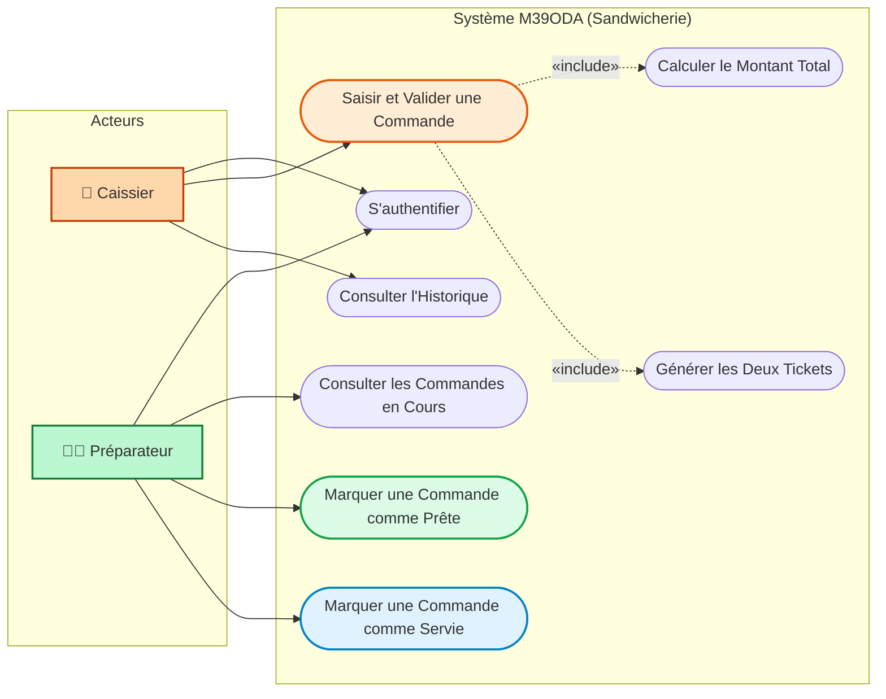
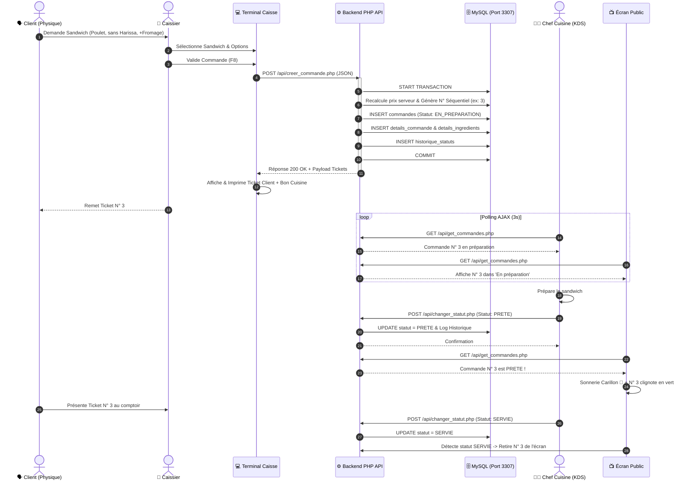

# 📋 Rapport d'Analyse, Conception & Développement : Système M39ODA
**Projet :** Gestion Informatisée des Commandes d’une Sandwicherie  
**Filière :** Développement Informatique / Génie Logiciel  
**Architecture :** PHP 8 Native • MySQL / MariaDB • Vanilla JS & CSS3 • AJAX Real-time

---

## 1. Contexte, Problématique & Objectifs

### 1.1. Contexte du Domaine
Une sandwicherie traditionnelle et artisanale (« M39ODA ») gère un flux important de clients aux heures de pointe. Les clients passent commande au comptoir en personnalisant leurs sandwichs (ingrédients de base, sauces, suppléments, omissions d'allergènes ou d'ingrédients spécifiques comme le piquant).

### 1.2. Problématique Initiale
* Les commandes transmises oralement ou sur papier entraînaient des erreurs récurrentes en cuisine (oublis des sauces, erreurs sur les suppléments payants).
* Les clients s'attroupaient devant le comptoir sans visibilité sur l'état d'avancement de leur préparation.
* Absence de traçabilité des temps de préparation et des transactions de caisse.

### 1.3. Objectifs du Système
1. **Zéro Erreur de Transmission** : Saisie assistée à la caisse avec génération automatique d'un ticket client et d'un bon de cuisine détaillé.
2. **Synchronisation Temps Réel (KDS)** : Affichage instantané des commandes en cours de cuisson sur l'écran du chef préparateur.
3. **Information Client Transparente** : Affichage dynamique sur écran d'appel public (*En préparation* vs *Prêtes*).
4. **Intégrité Métier Stricte** : Contrôle serveur des transitions d'états et calcul infalsifiable des prix.

---

## 2. Périmètre, Acteurs & Règles de Gestion

### 2.1. Identification Rigoureuse des Acteurs (Norme UML)
* **Caissier (Acteur Principal)** : Authentifié sur le terminal de caisse. Saisit les articles, configure les préférences demandées par le client, valide la transaction et remet le ticket de caisse.
* **Préparateur (Acteur Principal)** : Opère dans la zone de cuisine. Consulte les commandes, assemble les sandwichs selon les consignes, déclare les commandes prêtes, puis servies.
* **Le Client (Non-Acteur UML)** : Interagit oralement avec le caissier au comptoir physique. Il n'a aucun compte ni interaction directe avec l'interface logicielle.
* **L'Écran d'Appel Public (Dispositif Sortie)** : Dispositif d'affichage passif piloté par le système.

### 2.2. Règles de Gestion (RG01 à RG09)
* **RG01 (Numérotation Intuitive)** : Chaque commande validée reçoit un numéro séquentiel journalier clair et immédiatement compréhensible par le client (`1`, `2`, `3`...).
* **RG02 (Composition Minimale)** : Une commande doit comporter au moins un sandwich (`quantite >= 1`).
* **RG03 (Granularité des Préférences)** : Chaque sandwich peut recevoir des actions d'ingrédients explicites :
  - `RETIRER` : Omission d'ingrédients de base (ex: *Sans Harissa*, *Sans Oignon*).
  - `AJOUTER` : Sauces gratuites ou suppléments tarifés (ex: *Fromage Cheddar +4 DH*, *Frites +3 DH*).
* **RG04 (Double Impression Automatique)** : La validation génère simultanément le **Ticket Client** (reçu de paiement) et le **Bon de Cuisine** (consignes de fabrication).
* **RG05 (Statut Initial)** : Toute commande validée naît strictement dans l'état `EN_PREPARATION`.
* **RG06 (Autorité de Statut)** : Seul le préparateur est habilité à faire transiter une commande vers les statuts `PRETE` puis `SERVIE`.
* **RG07 (FSM & Cycle de Vie Strict)** : Le système interdit formellement le saut direct de `EN_PREPARATION` à `SERVIE`. Le passage par l'état `PRETE` est obligatoire.
* **RG08 (Diffusion Temps Réel)** : Toute modification de statut effectuée en cuisine se reflète immédiatement sur l'écran d'appel client sans rechargement de page.
* **RG09 (Conservation & Traçabilité)** : Les commandes servies disparaissent des écrans opérationnels mais restent archivées avec leur historique de statut complet (`historique_statuts`).

---

## 3. Modélisation UML

### 3.1. Diagramme de Cas d'Utilisation



---

### 3.2. Diagramme de Séquence : Cycle de Vie d'une Commande



---

## 4. Modélisation des Données (MERISE)

### 4.1. Modèle Conceptuel de Données (MCD)
* **UTILISATEUR** (<u>id_utilisateur</u>, nom, login, mot_de_passe, role, actif)
* **SANDWICH** (<u>id_sandwich</u>, nom, description, image_url, badge, categorie, prix, disponible)
* **INGREDIENT** (<u>id_ingredient</u>, nom, prix_supplement)
* **COMMANDE** (<u>id_commande</u>, numero_commande, date_commande, statut, montant_total)

**Associations & Cardinalités :**
* `ENREGISTRER` : UTILISATEUR (1,n) <---> (1,1) COMMANDE
* `CONTENIR` : COMMANDE (1,n) <---> (0,n) SANDWICH *(Propriétés : quantite, prix_unitaire, commentaire)*
* `PERSONNALISER` : DETAIL_COMMANDE (0,n) <---> (0,n) INGREDIENT *(Propriétés : action, prix_applique)*
* `HISTORISER` : COMMANDE (1,n) <---> (0,n) UTILISATEUR *(Propriétés : ancien_statut, nouveau_statut, date_changement)*

---

### 4.2. Modèle Logique de Données (MLD Normalisé 3NF)

```
utilisateurs (id_utilisateur, nom, login, mot_de_passe, role, actif)
    PRIMARY KEY (id_utilisateur)

sandwichs (id_sandwich, nom, description, image_url, badge, categorie, prix, disponible)
    PRIMARY KEY (id_sandwich)

ingredients (id_ingredient, nom, prix_supplement)
    PRIMARY KEY (id_ingredient)

commandes (id_commande, numero_commande, date_commande, id_caissier, statut, montant_total)
    PRIMARY KEY (id_commande)
    FOREIGN KEY (id_caissier) REFERENCES utilisateurs(id_utilisateur)

details_commande (id_detail, id_commande, id_sandwich, quantite, prix_unitaire, commentaire)
    PRIMARY KEY (id_detail)
    FOREIGN KEY (id_commande) REFERENCES commandes(id_commande)
    FOREIGN KEY (id_sandwich) REFERENCES sandwichs(id_sandwich)

details_ingredients (id_detail, id_ingredient, action_ingredient, prix_applique)
    PRIMARY KEY (id_detail, id_ingredient)
    FOREIGN KEY (id_detail) REFERENCES details_commande(id_detail)
    FOREIGN KEY (id_ingredient) REFERENCES ingredients(id_ingredient)

historique_statuts (id_historique, id_commande, id_utilisateur, ancien_statut, nouveau_statut, date_changement)
    PRIMARY KEY (id_historique)
    FOREIGN KEY (id_commande) REFERENCES commandes(id_commande)
    FOREIGN KEY (id_utilisateur) REFERENCES utilisateurs(id_utilisateur)
```

---

## 5. Arguments Clés pour la Soutenance (Pour décrocher la 1ère Place 🏆)

Lors de la présentation devant le jury ou vos professeurs, mettez en avant les points d'excellence suivants :

1. **Rigueur Conceptuelle UML & MERISE** :
   - Distinguer clairement l'acteur physique (Client) des acteurs logiciels (`Caissier` et `Préparateur`).
   - Schéma relationnel strictement normalisé en **3ème Forme Normale (3NF)**.
2. **Machine à États Finis (FSM) Inviolable** :
   - Démontrez que le backend bloque les transitions illégales grâce au code HTTP `409 Conflict`. Une commande ne peut pas sauter l'étape de préparation.
3. **Sécurité Financière & Transactions Atomiques** :
   - Aucun prix n'est accepté aveuglément depuis le navigateur. Les calculs sont recalculés en base dans une transaction `START TRANSACTION` / `COMMIT`.
4. **Ergonomie Pensée pour le Métier Réel** :
   - Présentation sous forme de « Food Boxes » avec visuels gourmands, raccourci clavier `F8`, retour haptique et sonore Web Audio, et impression thermique `@media print`.
5. **Portabilité Immédiate** :
   - Architecture PHP native sans dépendance lourde, prête à être déployée en un clic sur XAMPP local ou en ligne sur InfinityFree.

