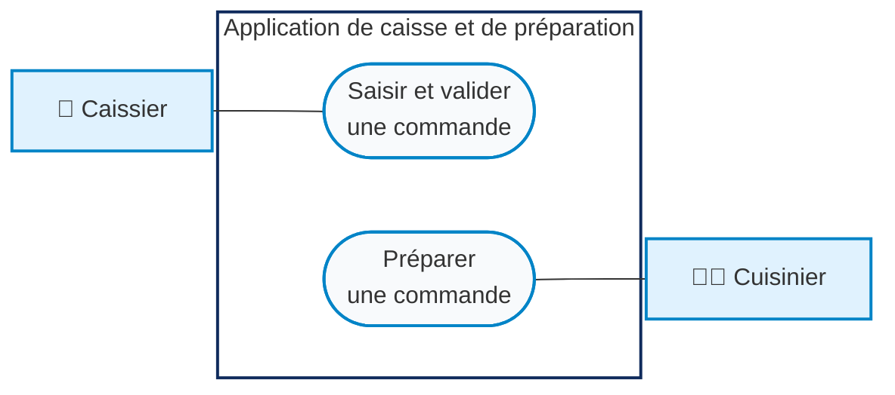

# Application de caisse et de préparation
### Sandwicherie

---

## 1. Diagramme UML de cas d’utilisation

*Figure 1 — Diagramme de cas d’utilisation. Le caissier et le cuisinier, acteurs externes, sont reliés par une association simple à leur cas d’utilisation respectif.*

---

## 2. Descriptions textuelles des cas d’utilisation

### 2.1 Cas d’utilisation 1 — Saisir et valider une commande

#### 1. Nom du cas d’utilisation
Saisir et valider une commande.

#### 2. Acteur principal
Caissier.

#### 3. Préconditions
* Le caissier est connecté à son espace de caisse.
* Le menu des sandwichs est disponible.

#### 4. Scénario nominal
1. Le caissier consulte le menu et sélectionne le sandwich demandé par le client.
2. Il appuie sur le bouton « Ajouter » de la carte du sandwich.
3. Le système ouvre une fenêtre de personnalisation affichant les ingrédients de base, cochés par défaut.
4. Le caissier peut décocher les ingrédients qu’il souhaite retirer.
5. Il peut également sélectionner des suppléments, par exemple des oignons, une sauce, du cheddar ou du fromage.
6. Il confirme sa personnalisation. Le sandwich personnalisé est ajouté au récapitulatif.
7. Le caissier répète cette opération pour chaque sandwich de la commande.
8. Il peut modifier les quantités ou supprimer une ligne du récapitulatif.
9. Le système met automatiquement à jour le total à payer.
10. Le caissier saisit le montant reçu en espèces.
11. Le système calcule automatiquement la monnaie à rendre.
12. Le caissier vérifie le récapitulatif, le montant reçu et la monnaie.
13. Il appuie sur « Valider la commande ».
14. Le système enregistre la commande et ses articles personnalisés dans la base de données avec le statut `EN_PREPARATION`.
15. Le système affiche le ticket de la commande.
16. Le ticket peut être imprimé.

#### Informations figurant sur le ticket
* Numéro de commande.
* Articles commandés.
* Personnalisations des sandwichs.
* Total à payer.
* Montant reçu.
* Monnaie à rendre.

> **Précision importante :** dans la version actuelle, les suppléments n’ont pas de prix supplémentaire.

#### 5. Scénarios alternatifs
* **A1 — Aucun sandwich sélectionné**
  * Le caissier tente de valider une commande vide.
  * Le système lui demande de sélectionner au moins un sandwich.
  * La validation est bloquée.
* **A2 — Montant reçu insuffisant**
  * Le montant reçu est inférieur au total de la commande.
  * Le système empêche la validation.
* **A3 — Abandon de la commande**
  * Le caissier quitte l’écran sans valider la commande.
  * La commande n’est pas enregistrée dans la base de données.

#### 6. Postconditions
* **En cas de succès :**
  * La commande est enregistrée dans la base de données.
  * Les articles et leurs personnalisations sont enregistrés.
  * Le statut de la commande est `EN_PREPARATION`.
  * La commande apparaît dans la file du cuisinier.
  * Le ticket est affiché et peut être imprimé.
* **En cas d’abandon :**
  * Aucune commande n’est enregistrée.

#### 7. Ergonomie de l’interface
L’interface du caissier doit être simple, intuitive et rapide à utiliser.  
Chaque carte de sandwich possède un seul bouton « Ajouter ». Lorsqu’il appuie sur ce bouton, une petite fenêtre de personnalisation apparaît. Elle affiche les ingrédients de base, cochés par défaut, et permet au caissier de décocher ceux à retirer ou de sélectionner des suppléments. Après confirmation, le sandwich personnalisé apparaît dans le récapitulatif.

Le récapitulatif affiche clairement :
* Les sandwichs sélectionnés.
* Leurs quantités.
* Leurs personnalisations.
* Le total à payer.

Le caissier saisit ensuite le montant reçu en espèces. La monnaie à rendre est calculée automatiquement. Après vérification, il appuie sur « Valider la commande ».  
Le système enregistre la commande et affiche le ticket avec toutes les informations nécessaires. Le ticket peut être imprimé.

---

### 2.2 Cas d’utilisation 2 — Préparer une commande

#### 1. Nom du cas d’utilisation
Préparer une commande.

#### 2. Acteur principal
Cuisinier.

#### 3. Préconditions
* Le cuisinier est connecté à son espace cuisine.
* Une commande validée peut être présente dans la file avec le statut `EN_PREPARATION`.

#### 4. Scénario nominal
1. Le cuisinier accède à son espace cuisine.
2. Le système affiche les commandes ayant le statut `EN_PREPARATION`.
3. Les commandes apparaissent sous forme de tickets.
4. Lorsqu’un nouveau ticket arrive, le système ouvre une fenêtre détaillée.
5. Le ticket présente les informations suivantes :
   – Numéro de commande.  
   – Heure de réception.  
   – Sandwichs commandés.  
   – Quantités.  
   – Ingrédients à retirer.  
   – Suppléments à ajouter.  
   – Montants par article.  
   – Total de la commande.  
6. Le cuisinier consulte le ticket.
7. Il prépare les sandwichs conformément aux personnalisations indiquées.
8. Lorsque la commande est terminée, il appuie sur « Commande prête ».
9. Le système enregistre le nouveau statut `PRETE`.
10. Le ticket disparaît de la file des commandes à préparer.

#### 5. Scénarios alternatifs
* **A1 — File vide**
  * Le cuisinier accède à son espace cuisine.
  * Aucune commande n’est en attente.
  * Le système affiche un message indiquant que la file est vide.
* **A2 — Préparation non terminée ou non confirmée**
  * Le cuisinier n’appuie pas sur « Commande prête ».
  * Le système conserve le statut `EN_PREPARATION`.
  * La commande reste dans la file des commandes à préparer.

#### 6. Postconditions
* **Après confirmation :**
  * Le statut de la commande devient `PRETE`.
  * Le ticket disparaît de la file des commandes à préparer.
* **Sans confirmation :**
  * Le statut reste `EN_PREPARATION`.
  * Le ticket reste dans la file.

#### 7. Ergonomie de l’interface
L’interface du cuisinier est distincte de l’espace de caisse. Elle doit être claire, simple et conçue pour permettre une consultation rapide des commandes. Les commandes à préparer apparaissent sous forme de tickets.

Chaque ticket doit afficher de manière lisible :
* Le numéro de commande.
* L’heure de réception.
* Les sandwichs demandés.
* Les quantités.
* Les ingrédients à retirer.
* Les suppléments à ajouter.
* Les prix.

Le cuisinier doit pouvoir consulter les détails du ticket pendant la préparation. Le bouton « Commande prête » doit être facilement identifiable et bien visible. Lorsque la file est vide, un message explicite doit être affiché. Après confirmation, le ticket disparaît automatiquement de la file.

